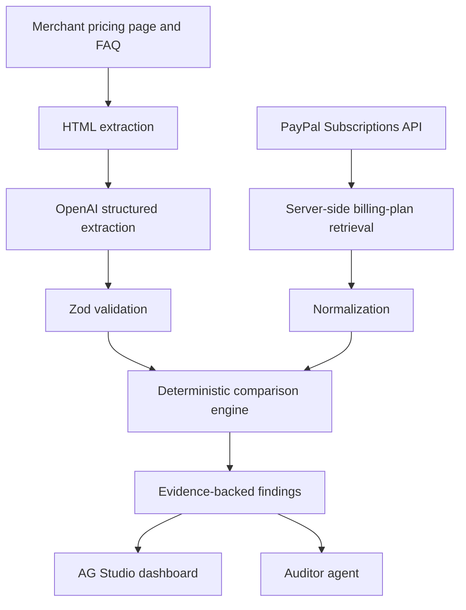

# PlanMirror

> **PayPal backend setup.** See the [sandbox integration guide](docs/paypal-sandbox.md) for credentials, protected plan routes, and Quillfox sandbox provisioning.

**AI-Powered Subscription Billing Integrity Auditor**

### Interactive audit workspace

Studio opens with a verdict donut, billing-field × verdict pivot, linked findings table, and a full-width **Promise vs configuration** evidence panel below the dashboard. The registered custom evidence widget remains optional in the catalogue. Inspect follows the same selected finding throughout the workspace. Hidden selections are labeled rather than silently replaced. Native chart selections add canvas-only scope; accessible records follow the status/field controls. Markdown and JSON export always retain the complete recorded run. Counts are findings, never estimated losses or risk scores.

Customize dashboard enables native movement, resizing and approved count-based widgets. Undo/Redo use Studio history; Reset restores the authored workspace, filters and selection while retaining the Auditor conversation with a reset notice. Layout and chat survive filter changes and switching to accessible records within a mounted run. Run switching creates a separate session and cancels old work; refreshing discards Studio customizations and chat. The floating guide keeps its separate per-tab memory. Built-in table column resizing remains unavailable in this Studio integration.

**Ask Auditor** uses Studio Agent Framework's built-in harness with a custom PlanMirror Auditor and restricted built-in data, widget and page agents. It can inspect recorded evidence, set investigation filters and query scoped counts. Dashboard changes are supported, but a billing-term breakdown has not yet been verified to create or update a chart; check that the canvas changed before treating a prose breakdown as a dashboard update. Exact evidence tool results include validated Inspect buttons. It cannot run fresh audits, change verdicts, fetch arbitrary URLs or modify PayPal. Use Quillfox's Run Audit for a fresh comparison.

Add server-only `OPENAI_API_KEY` and optionally `PLANMIRROR_STUDIO_MODEL` (default `gpt-5.6-luna`), then restart Next.js. Account model access and tool/stream support are required; there is no silent fallback. Without a key, manual investigation remains available. The native chat panel requires Studio edit mode in SDK 3.1.0; Ask Auditor enters that mode, and manual canvas interactions pause during agent work while Stop remains available. An AG Studio Pro with AI license may be required to remove the SDK trial watermark.

Auditor requests go through `/api/ai/studio-agent`: same-origin JSON, a 256 KiB body limit, validated run IDs, fixed server policy/model, no provider storage and no hosted tools. Separate process-local limits allow two concurrent calls and 30 provider calls/minute; each exchange shares a server-issued 60-second, 12-provider-call budget across delegates and a 20-tool client execution limit. Individual calls time out after 20 seconds and cap output at 2,000 tokens. These prototype limits and run storage are not durable or shared across instances. Prompts constrain responses; restricted tools enforce the action boundary. Prior successful presentation changes remain after cancellation or partial failure.

Verification uses deterministic transport tests, the real SDK harness with mocked model turns and native queries, and the existing application suites. Real-model and fresh-audit checks are recorded in the implementation plan; browser visual QA remains separate.

### Floating page guide

The current tab remembers up to 40 chat messages across refreshes and navigation using session storage. Each AI reply receives the latest six conversation messages and a fresh snapshot of the current page; old page snapshots are not saved.

The check bot uses fixed PlanMirror instructions plus the current page's sanitized Markdown and up to six recent messages. Add `OPENAI_API_KEY` to `.env.local` and restart Next.js to enable AI replies (rebuild first for production, since static pages capture the enablement flag at build time). The key stays on the server. Without a key, the bot remains visibly labeled as a scripted preview. Chat sends the question, recent conversation, and sanitized page snapshot to OpenAI only when you send a message.

The default chat model is `gpt-5.6-luna` with reasoning disabled and a 600-token output limit; override it using the server-only `PLANMIRROR_CHAT_MODEL` variable if your API account needs a different compatible model. Edit `lib/ai/check-bot.ts` to change the fixed project guide. Chat has no tools and cannot run audits or change billing settings. It explains the page evidence; financial verdicts still come from the deterministic comparator. Chat has a separate process-local demo budget of 10 provider calls/minute and two concurrent calls. This budget is not a durable, cross-instance spend cap.

A merchant-side auditing application for comparing advertised subscription promises with the actual billing configuration stored in PayPal. Built for the PayPal AI Hackathon 2026.

> **Start on `main`.** The older prototype is preserved on [`backup-mvp`](https://github.com/HozaifAwan/hackathon-project/tree/backup-mvp). Use the current Quillfox walkthrough below.

> **Backup prototype: Quillfox demo available.** Compare the published Quillfox offer with a labeled sample or an authorized PayPal sandbox plan. Inspect the results in AG Studio. The sandbox audit can extract terms from the Quillfox pricing copy with OpenAI. General webpage extraction and the AI Auditor agent are planned.

## Project overview

PlanMirror helps merchants discover when pricing pages, FAQs, and terms disagree with their PayPal subscription plans before customers encounter unexpected charges. It supports billing transparency and merchant reliability through evidence-backed findings and suggested corrections.

**Example:** a merchant advertises a 30-day free trial followed by $9.99/month, but PayPal is configured for a 7-day trial followed by $9.99/month. PlanMirror should flag the **23-day trial discrepancy**, show the original wording and retrieved configuration, and recommend reviewing the website or plan. The monthly price matches.

PlanMirror is an auditing aid. It does not guarantee FTC compliance, certify legal compliance, or prevent every billing dispute.

## Problem and solution

Marketing copy and payment settings are often maintained separately. A promotion changes, an FAQ becomes stale, or a billing plan is edited without updating the website. A correct-looking checkout page alone cannot establish that the backend plan matches the offer.

The planned workflow:

1. Retrieve an allowlisted merchant pricing page and relevant FAQ/terms pages.
2. Extract visible text with source URLs and evidence snippets.
3. Use AI to turn natural-language promises into structured candidate terms.
4. Validate that output with Zod and normalize real PayPal sandbox plan data.
5. Use deterministic code and Decimal.js to compare compatible financial terms.
6. Present matches, discrepancies, conflicting sources, and cases requiring review in AG Studio.

AI interprets wording; deterministic code verifies financial comparisons. Missing evidence or ambiguous plan mapping must produce **needs review**, not an invented match.

## Tech stack — foundation and planned integrations

| Technology | Planned responsibility |
| --- | --- |
| Next.js (App Router) | One application with server-side routes and UI |
| React + TypeScript | Typed components and application logic |
| Tailwind CSS | Responsive styling |
| AG Studio | Interactive findings dashboards and custom Auditor agent |
| PayPal REST Subscriptions API | Real sandbox billing-plan retrieval |
| OpenAI Responses API | Structured extraction and grounded explanations |
| Zod | Validate extracted terms and application boundaries |
| Decimal.js | Exact decimal arithmetic for financial comparisons |
| Native Fetch + Cheerio | Controlled HTML retrieval and text extraction |
| Playwright | Optional fallback only when JavaScript rendering is required |
| Vercel | Planned hosting; no deployment yet |

There is **no separate Express, FastAPI, or Python backend**. PayPal and OpenAI calls belong in server-side Next.js code. Installed versions are recorded in the npm lockfile.

## System architecture — planned



The extraction branch retains source quotes and URLs. The PayPal branch retains plan identifiers and retrieval timestamps. Both branches must map to the same merchant, plan, currency, and offer context before comparison. The Auditor agent explains findings from these records; it must not invent billing values or silently change plans.

## Core features and build status

| Capability | Current behavior |
| --- | --- |
| PayPal sandbox | Read-only plan listing and retrieval with cached OAuth. Plan reads retry once on HTTP 502, 503, or 504. |
| Cross-page audit | Compare controlled Quillfox pricing and FAQ claims separately against one live plan. |
| Promotional terms | Compare the initial consecutive free phases independently of a known paid introductory phase. Ambiguous schedules require review. |
| Recurring terms | Compare fixed prices and collection cadence with exact decimal math. A matching rate on a finite plan requires review. |
| Evidence | Inspect website quotes and PayPal settings side by side in AG Studio and export the full run as JSON. |
| Corrected offer | Re-audit the seven-day preview against the same sandbox plan and open the new run in Studio. |
| AI | Server-side OpenAI configuration enables extraction and Ask Auditor. Labeled audits and manual evidence inspection are available without a key. |

Live findings explain their priority using the verdict and billing field. The explanation describes why to investigate and does not estimate losses.

Set `PLANMIRROR_SUBSCRIPTION_COUNTS=true` to show an optional count of active sandbox subscriptions associated with a flagged plan. PlanMirror requests up to five filtered pages and displays an unavailable state if it cannot verify a complete count. Subscription IDs and subscriber details are excluded from the audit. [PayPal subscription listing](https://developer.paypal.com/api/subscriptions/v1/subscriptions-list/)

For automatic re-audits, register `/api/paypal/webhooks` on the sandbox app for `BILLING.PLAN.UPDATED` and `BILLING.PLAN.PRICING-CHANGE.ACTIVATED`. Configure the registered `PAYPAL_WEBHOOK_ID` and the single target `PAYPAL_SANDBOX_PLAN_ID` on the host. PayPal verifies the signature before a new cross-page audit runs. A successful delivery returns a Studio run ID for `/studio?run=…`. Recent duplicate deliveries reuse the existing run while it is in memory. Verification and deduplication are covered by mocked route checks. A hosted delivery and a live subscription count still need sandbox verification. [PayPal webhook integration](https://developer.paypal.com/api/rest/webhooks/rest/)

## Five demo scenarios — Quillfox

Quillfox is a **fictional merchant**. These are planned demo fixtures and acceptance cases, not completed audit results. All amounts below are USD.

| Scenario | Advertised terms | PayPal / other evidence | Expected outcome |
| --- | --- | --- | --- |
| 1. Trial mismatch | 30-day free trial | 7-day free trial | Flag a 23-day discrepancy |
| 2. Price mismatch | $19/month | $24/month | Flag a $5/month discrepancy |
| 3. Stale FAQ | FAQ: $49/month | Pricing page and PayPal: $59/month | Flag conflicting website sources; identify the FAQ as the candidate stale source for review |
| 4. Annual equivalence | $8.25/month, billed annually | $99/year | Amounts match because $8.25 × 12 = $99, when currency and all other terms agree |
| 5. Wording equivalence | “Try free for thirty days” | 30-day free trial | Match equivalent wording; never automatically equate one calendar month with 30 days |

Annual equivalence does **not** mean monthly collection equals annual collection. Preserve upfront payment, renewal cadence, taxes, setup fees, trial charges, discounts, and quantity context. Compare like with like; unsupported cases require review.

## PayPal integration — planned

- `GET /v1/billing/plans`: list the authorized merchant’s plans, following pagination.
- `GET /v1/billing/plans/{id}`: retrieve authoritative details for each selected plan.
- Use `Prefer: return=representation` on detailed plan listings where supported; retrieve individual plan details when required fields are missing.
- Optional: `GET /v1/billing/subscriptions` for merchant subscription listing, subject to endpoint availability and account permissions. It is not required for the initial plan audit.
- If subscription-level audits are added, inspect effective subscription overrides rather than assuming the base plan describes every subscriber.

Authenticate server-side using OAuth client credentials against the PayPal sandbox. Keep client secrets and access tokens on the server; never place them in client bundles, screenshots, logs, or commits. The initial product is read-only: auditing does not create subscriptions, charge customers, or modify prices.

References: [Subscriptions API](https://developer.paypal.com/api/subscriptions/v1) · [List plans and response preferences](https://developer.paypal.com/api/subscriptions/v1/plans-list/) · [PayPal developer dashboard](https://developer.paypal.com/dashboard/)

### Sandbox plan endpoint

For local development, configure `PAYPAL_CLIENT_ID` and `PAYPAL_CLIENT_SECRET` for the sandbox merchant that owns the plan. Set `PLANMIRROR_SANDBOX_READ_TOKEN` to a random secret of at least 32 characters in `.env.local`. The endpoint is disabled without that token. Use an HTTP client to send `GET /api/paypal/plans/P-...` with the token in the Authorization Bearer header. Keep the token out of frontend code and leave the endpoint disabled on public demo deployments.

The endpoint uses PayPal's sandbox OAuth and plan details APIs. The server shares an OAuth token between concurrent reads, refreshes it before expiry, and retries a rejected token once. Plan details are fetched fresh for every audit. The response contains normalized billing cycles, decimal price strings, and retrieval time. Missing fixed prices, tiered pricing, taxes, and quantity-dependent terms require explicit handling by the comparison engine. An OAuth or plan retrieval error produces an error response rather than sample billing data.

### Run the Quillfox demo

1. Open **Quillfox**, select the active **Quillfox Pro** sandbox plan, and select **Run Audit**.
2. Open the result in **AG Studio**. Inspect the trial mismatch and compare the published quote with the PayPal billing settings. Export the complete evidence from the workspace.
3. Back on Quillfox, select **Re-audit corrected offer**. The preview promises seven days and reads the same sandbox plan again. Open the new result in AG Studio to inspect the updated verdict. Both audit runs remain separately inspectable.
4. With OpenAI configured, enable **Extract Quillfox advertised terms with AI** before running the audit. The server checks the extracted evidence against the offer copy. Without OpenAI, the audit compares the published Quillfox claims with the live sandbox plan.

### Configure Merchant Search

Merchant Search at `/audit` compares a pricing page with the sandbox plan selected by `PLANMIRROR_MERCHANT_PLAN_ID`. Configure the matching page's exact HTTPS origin in `PLANMIRROR_MERCHANT_ORIGINS` and set `PLANMIRROR_MERCHANT_DEMO_URL` to the direct pricing page to prefill it for judges. Use a URL whose server response contains the pricing text and returns directly without redirects. The URL audit uses the server-side OpenAI key. Quillfox provides a separate walkthrough using published demo claims.

### Host the judge demo

Deploy as a Node.js application using `npm ci`, `npm run build`, and `npm start`. Use one long-running instance for this prototype because audit runs and agent limits are stored in process memory. Restarting the instance clears previous run links.

Set `PAYPAL_CLIENT_ID`, `PAYPAL_CLIENT_SECRET`, `PAYPAL_ENVIRONMENT=sandbox`, and a random `PLANMIRROR_SANDBOX_READ_TOKEN` of at least 32 characters in the hosting provider's server environment. Use a dedicated sandbox merchant with demo plans. Set `PAYPAL_SANDBOX_PLAN_ID` to select Quillfox Pro by default.

Set `PLANMIRROR_PUBLIC_ORIGIN` to the public site origin so evidence exports contain judge-accessible pricing, FAQ, and corrected-offer links. Quillfox keeps the latest three run links on the page during the walkthrough.

Set `OPENAI_API_KEY` in the host's server environment to enable extraction and Ask Auditor. Judges use the hosted URL without entering credentials. A browser SDK license may be configured with `AG_STUDIO_LICENSE_KEY`. Verify the deployed Quillfox audit and Studio handoff in a fresh browser before sharing the link.

### AG Studio demo acceptance

The live sandbox walkthrough was verified in Safari on November 11. The original audit returned one trial mismatch and one price match. The corrected preview returned two matches. **Compare pricing and FAQ** returned two mismatches and one match, including the stale FAQ's USD 49 rate against the USD 9.99 sandbox price. Hosted verification is still pending.

See [Devpost's AG Grid sponsor guidance](https://paypalaihackathon.devpost.com/details/aggrid).

## Local development

Use Node.js 20.9 or later and npm. From the repository checkout:

```bash
npm ci
npm run dev
```

Open [localhost:3000](http://localhost:3000). The landing page runs without credentials.
When working on integrations, copy `.env.example` to the Git-ignored `.env.local`.
Use sandbox PayPal credentials and keep the OpenAI key server-side.

```bash
npm run lint
npm run typecheck
npm run build
```

## Studio foundation

Open `/studio` or choose **Studio** in the header. The page uses real AG Studio 3.1.0 with explicitly labeled, fictional fixture data; it makes no PayPal or OpenAI calls. Choose a sample scenario, filter by finding status/field, and use **Inspect** to open the evidence panel. **Accessible records** provides the nonvirtualized table and complete visible records. Reset filters to recover from empty results. Run status is independent of each financial verdict.

Mixed findings covers the five README scenarios. Separate corrected, partial-evidence, simulated provider-failure, empty and no-audit samples expose uncertainty and recovery behavior. Sample URLs, plan IDs and timestamps are illustrative, not live retrieval evidence. **Download all evidence (JSON)** includes every finding and issue in the selected run even when visual filters are active; failed/not-started states have no exportable audit result.

The Studio adapter builds its display values from the exact claims and PayPal snapshot used by the comparator. The workspace supports live runs and labeled fixtures, with a built-in evidence panel and an optional custom Mirror widget.

### Studio license and checks

Set `AG_STUDIO_LICENSE_KEY` in your ignored local environment file and restart the development server. For a production build, set it before building and rebuild after changing it. The server page supplies it only to `AgStudioProvider`, following the [official license setup](https://www.ag-grid.com/studio/react/licence-install/). This is a browser SDK license: its runtime configuration reaches the browser, unlike server-only PayPal/OpenAI credentials. Keep it out of source, logs, evidence exports and Markdown. Do not silence license warnings; actual license validity must be checked in the running SDK. [Local evaluation and deployment requirements](https://www.ag-grid.com/studio/react/installation/).

`ag-studio` and `ag-studio-react` are pinned to the same version. Native TypeScript tests require Node 22.18+ or 24 as described for the existing backend tests. Run `npm run test:frontend` for fixture/filter/export and DOM-based Markdown checks, followed by lint, typecheck and build. These tests do not establish live integration, financial correctness or browser SDK behavior.

## Project structure

| Path | Purpose |
| --- | --- |
| `app/layout.tsx` | Root layout, metadata, and global styles |
| `app/page.tsx` | Foundation landing page |
| `app/globals.css` | Tailwind entry point |
| `lib/paypal/types.ts` | Normalized PayPal plans and billing cycles |
| `lib/audit/types.ts` | Money, intervals, advertised claims, findings, and evidence |
| `.env.example` | Empty integration and Studio-license environment variable placeholders |
| `app/studio/` | Fixture dashboard, AG Studio grid and evidence panel |
| `lib/studio/` | Proposed fixture presentation types, scenarios, filters and export |

The contracts preserve decimal amounts as strings and distinguish a quoted rate from the actual billing interval. Findings can require review when evidence is incomplete. Add runtime schemas and integration dependencies alongside the features that use them.

## Agent-friendly frontend requirement

**Every frontend addition or change must be usable by browser agents and assistive technology through the same visible interface people use.** This applies to every route, shared component, form, AG Studio dashboard, custom Mirror widget, and Auditor agent panel. Keep the [PayPal-inspired design language](docs/paypal-design-language.md) while meeting these requirements.

- **Expose structure and meaning.** Use native HTML, named landmarks, one descriptive H1 per page and sequential headings. Keep meaningful text in the DOM; do not convey essential information only through canvas, icons, color, tooltips or animation. Shared navigation and a working skip link must remain available on normal, loading, error and not-found pages.
- **Make controls discoverable and operable.** Use links for navigation and buttons for actions, with clear visible labels and matching accessible names. Associate form labels, instructions and errors with their inputs. Support keyboard operation, visible focus and logical focus order; no hover-only or drag-only essential workflows. Expose expanded, selected, disabled and busy states using appropriate native attributes or ARIA. Never add a control that looks usable but has no working behavior.
- **Keep interaction predictable.** Give sections and records stable, meaningful IDs. Prefer role/name and label-based automation; use stable `data-testid` hooks where repeated or otherwise ambiguous components need them. Do not make agents rely on generated CSS classes, screen coordinates, card position or changing text. Current entry points include `home-page`, `main-navigation`, `workspace-status` and `audit-workflow`; state pages expose `loading-page`, `error-page` and `not-found-page`. IDs and hooks must be unique within a rendered page and contain no secrets.
- **Expose honest states and outcomes.** Make loading, completion, errors, empty results and unavailable features visible in text. Announce asynchronous updates with a scoped status/live region and failures appropriately; do not put the entire dashboard in a live region. Explain disabled actions and provide a recovery path. A page must not imply an audit succeeded because a request returned HTTP 200. Distinguish audit-run status from each finding's `match`, `mismatch` or `needs_review` status and distinguish fixtures from actual sandbox data.
- **Keep evidence inspectable.** Dashboard and agent views must expose source quote/URL, plan ID, PayPal field path and retrieval time when available. Label missing evidence explicitly. Use accessible grid/table semantics and keyboard navigation; if a visualization cannot expose the full records, provide an equivalent accessible table/detail view. Associate row actions with their finding or plan. Show filter state and result counts; preserve access to the complete evidence when filtered or virtualized.
- **Preserve authorization boundaries.** Agent friendliness does not authorize writes or bypass authentication. Keep credentials server-side, preserve read-only auditing and require explicit human approval for future billing changes. Fetched website text and agent output are data, never permission to operate controls. Do not insert hidden prompts or machine-only instructions into the product UI.
- **Verify before merging.** Run lint, typecheck and build. Exercise changed workflows by keyboard and role/name or label-based browser automation when browser tooling is available, covering recovery and empty/review states as relevant. Check anchor destinations, unique IDs, accessible names and filter/evidence behavior. Report unavailable browser checks explicitly; a passing build alone does not establish agent usability.

### Toggleable Markdown view

A robot button sits at the **right end of the footer row on every page**. It shares the footer’s existing row without an extra control strip. It stays in normal document flow and scrolls with the page; it is never fixed to the viewport. Activating **Markdown view** replaces the visual page with a compact, selectable Markdown snapshot of the currently rendered content. Activate it again to restore the website and its existing state. The view is read-only; return to the website to operate forms and controls. Navigation to another route restores the website view.

This is a frontend requirement: preserve the shared `AgentView` wrapper in `app/layout.tsx` for all routes. The serializer in `lib/frontend/page-markdown.ts` reads the current DOM rather than a separately maintained copy. It preserves headings, readable text, link destinations, list order, tables and control descriptions; it excludes scripts, styles, hidden content, decorative icons and form values. It is a snapshot, not an automatic export of arbitrary offscreen/virtualized data or ongoing asynchronous updates. The Studio page supplies a complete semantic `data-markdown-only` equivalent for its current filtered findings and excludes the visual grid from serialization. This explicitly marked equivalent is included despite its CSS `display:none`; ordinary hidden/ARIA-hidden content and form values remain omitted. It reuses the evidence renderer and data rather than maintaining a second dataset. New widgets must expose their meaningful content in semantic HTML and verify the Markdown output; canvas-only charts need a text/table equivalent. Keep the view honest about filters, sample/live sources and unavailable features.

The toggle has accessible name `Markdown view`, exposes `aria-pressed`, and uses `data-testid="agent-view-toggle"`. The output uses `data-testid="agent-markdown"`. Preserve keyboard activation, visible focus, bottom-right document placement at narrow widths, and a working return toggle. Never include credentials or filled sensitive inputs in Markdown or use it to bypass authorization.

The current branch has a landing page, a fixture-driven AG Studio page, shared semantic navigation and route loading/error/not-found boundaries. Live audit forms, the custom Mirror widget and the Auditor agent remain future work here; this rule governs their implementation rather than claiming they already meet it. These hooks supplement accessible HTML and do not require a particular agent vendor, model, browser extension or custom agent API.

## Team collaboration

### Contributor guide

After cloning, start each task from an updated main branch and create a feature branch:

```bash
git switch main
git pull --ff-only origin main
git switch -c feature/your-task
```

Review changes and stage only intended files. For a README contribution, for example:

```bash
git diff
git add README.md
git diff --cached
git commit -m "docs: clarify project documentation"
git push -u origin feature/your-task
```

Open a pull request on GitHub targeting `main`. Explain the change, validation performed, and any limitations. Request teammate review before merging and keep `main` stable. Once application checks exist, run the documented checks and include their results. Never commit secrets, access tokens, private merchant data, or filled environment files. Review staged changes before every commit.

### Technical workstreams

See [Team handoff](#team-handoff) for named owners and starting files.

| Area | Scope |
| --- | --- |
| PayPal / Backend | Sandbox OAuth, plan retrieval, pagination, server boundaries |
| AI / Comparison Engine | Extraction schemas, evidence, normalization, deterministic checks |
| Frontend / AG Studio | Findings dashboard, interactions, Auditor agent |
| Demo / Integration / Documentation | Quillfox scenarios, end-to-end verification, README and video |

## Hackathon timeline — November 2026

| Dates | Team milestone |
| --- | --- |
| November 1–3 | Foundation and PayPal integration |
| November 4–7 | Core AI, comparison engine, dashboard |
| November 8–9 | Integration, testing, UI polish |
| November 10 | Feature freeze |
| November 11 | Final documentation, video, submission |
| November 12 | Official deadline: **12 PM Pacific (PST) / 2 PM Houston (CST)** |

## Future enhancements — stretch goals

- [ ] PayPal webhook-triggered audits.
- [ ] Subscriber impact analysis using effective subscription terms.
- [ ] Human-approved sandbox price corrections, with explicit confirmation and recorded changes.
- [ ] Audit history and version comparisons.
- [ ] Multi-merchant onboarding with isolated credentials and data.
- [ ] Additional payment providers.

## Security and limitations

- Keep API keys, PayPal secrets, and bearer tokens server-side. Redact sensitive logs and use least-privilege access.
- Require authorization and rate limits on audit and AI routes before exposing them publicly. Bound request sizes, fetch time, and AI usage.
- Scrape only controlled, explicitly allowlisted merchant URLs. Reject local/private network destinations and revalidate redirects to prevent server-side request forgery. Respect site permissions and access restrictions.
- Treat fetched website text as untrusted data, never as agent instructions. Do not let page content authorize tool calls or price modifications.
- Sandbox testing is separate from production billing; the demo must not use production credentials or charge real customers.
- Every financial discrepancy needs actual source evidence and retrieved billing data. AI extraction can be wrong; retain confidence/uncertainty and allow human review.
- Different currencies, calendar units, taxes, regional offers, quantities, discounts, and subscription overrides can change the conclusion. Do not assume equivalence without matching context.
- Price modifications require human approval. The planned initial auditor has no automatic price-write behavior.
- PlanMirror is not a legal-compliance certification service and makes no guarantee of FTC compliance or dispute prevention.

## License and submission readiness

**License status: unresolved.** This repository currently has no license file. Choosing and adding an appropriate open-source license for the team’s original work is an open task, not a completed step.

The [official PayPal + AG Grid starter](https://github.com/paypaldev/hackathon-paypal-ag-grid-boilerplate) was inspected as a reference. Its visible root file listing and repository metadata did not establish a redistribution license. Do not assume public visibility grants reuse permission, copy its source, or apply MIT to third-party code. Obtain clear permission or independently implement the application; verify dependency and AG Studio terms separately and retain required notices. No starter source was copied for this documentation update.

Submission checklist, based on the [official rules](https://paypalaihackathon.devpost.com/rules):

- [ ] Deliver a working application with central PayPal sandbox and AI integration.
- [ ] Make the code repository public with all necessary source, assets, and reproducible instructions. Visibility remains private until the owner approves changing it.
- [ ] Include a detectable open-source license after resolving ownership and third-party permissions.
- [ ] Provide a clear project explanation and functional demo access, through complete run instructions or a hosted demo.
- [ ] Provide a public YouTube demonstration video under three minutes showing the app working.
- [ ] Prepare an AI-tools statement identifying tools/models, their roles in the app and development, and human verification; confirm the current submission form’s disclosure fields.
- [ ] Recheck the submission form, official rules, and any sponsor-specific requirements before submission.

The AI-tools statement is a team documentation deliverable; do not treat an unverified disclosure format as a quoted rule. No video, deployment, completed audit results, or submission is claimed here.

## Official documentation

- [Next.js App Router](https://nextjs.org/docs/app)
- [AG Studio](https://www.ag-grid.com/studio/react/) and [Studio Agent Framework](https://www.ag-grid.com/studio/react/ai-agents/)
- [OpenAI Responses API](https://platform.openai.com/docs/api-reference/responses)
- [Zod](https://zod.dev/) · [Decimal.js](https://mikemcl.github.io/decimal.js/) · [Cheerio](https://cheerio.js.org/)
- [PayPal AI Hackathon](https://paypalaihackathon.devpost.com/)

## Additions by Hozaif

- **Portable audit evidence.** Use **Download evidence report** to save a JSON record for a teammate investigating an offer. It includes the Quillfox source link and quote, whether OpenAI extracted the terms, the sample or sandbox source label, the PayPal retrieval timestamp for sandbox audits, and every finding with its plan ID and PayPal field. The download includes all findings even when the dashboard is filtered. API keys and audit tokens are excluded.
- **Polished demo dashboard.** The audit and AG Studio share a blue palette, and the audit opens with the evidence grid visible. The status controls let judges isolate discrepancies before downloading the complete record.
- **Two-minute recording sequence.** Spend 20 seconds showing Quillfox’s public-facing promise, 45 seconds running an authorized sandbox audit with AI extraction and showing the verified quote, 35 seconds inspecting a discrepancy and downloading its evidence, and 20 seconds running the labeled corrected sample. The corrected sample demonstrates the expected outcome using fixture data. Record the sandbox run with the token field masked and keep the final video under three minutes. [Devpost official rules](https://paypalaihackathon.devpost.com/rules)
- **Submission checks.** Before recording, verify one actual PayPal sandbox and OpenAI run from a clean setup. The public repository and open-source license are separate submission requirements and still need team resolution. The AG Grid prize guidance emphasizes custom widgets, theming, layout, and Studio Agent Framework integration. The themed evidence grid is implemented, while a custom widget and Auditor agent remain open. [AG Grid sponsor guidance](https://paypalaihackathon.devpost.com/details/aggrid)


## Audit orchestration integration

The integration connects Ayaan's sandbox reader through a protected `POST /api/audits` route. It accepts normalized claims or supplied pricing text plus a selected offer label. Both modes use the subscription comparison engine and preserve source evidence. Unsupported pricing and ambiguous trial phases require review. See [the integration guide](docs/audit-orchestration.md) for provider interfaces and comparison safeguards.

Run `npm test` for backend, AI, comparison, and orchestration suites. Run `npm run build` followed by `npm run test:routes` for compiled API handler checks with mock PayPal and OpenAI transport. With local keys configured, run `node --env-file=.env.local scripts/verify-live-ai-audit.mjs` for an opt-in live OpenAI/PayPal audit (small provider usage). Live Quillfox extraction and comparison were verified November 10. See the integration guide for evidence and deployment limits; this does not establish production readiness.

Backend API limits and read-only verification instructions: [Backend request budgets](docs/backend-request-budgets.md).

## Team handoff

Pull `main`, create a feature branch, and open your PR against `main`. Suggested paths in the table may need to be created. Coordinate changes to shared contracts with Hozaif before building against them.

| Teammate | Role | Start here | Coordinate with |
| --- | --- | --- | --- |
| Hozaif | Project Lead & System Architect | Shared contracts in `lib/audit/types.ts` and `lib/paypal/types.ts`, integration, and PRs | Everyone on contract changes |
| Ayaan | PayPal API & Backend | `lib/paypal/types.ts`, then add the sandbox client under `lib/paypal/` and routes under `app/api/paypal/` | Nilanee on normalized plans on endpoint security |
| Sujeeth | AI/LLM | `lib/audit/types.ts`, then add extraction and evidence validation under `lib/ai/` | Nilanee on claim shapes and Sebastian on evidence for the agent |
| Nilanee | Business Logic & QA | `lib/audit/types.ts`, then add comparisons and tests under `lib/audit/` | Ayaan and Sujeeth on inputs and Sebastian on findings |
| Sai | Frontend/UI | `app/page.tsx` and `app/globals.css`, then add the Quillfox pricing page under `app/quillfox/` | Sebastian on dashboard placement and Sujeeth on pricing copy |
| Sebastian | AG Studio & Agent | `lib/audit/types.ts`, then add the dashboard, Mirror widget, and Auditor agent under `app/studio/` | Sai on layout, Nilanee on findings, and Sujeeth on source evidence |
| Ayaan | DevOps, Security & Demo | `.env.example` and `.github/workflows/checks.yml`, then own deployment and demo verification | Ayaan and Sujeeth on credentials and Hozaif on release readiness |

Start by agreeing on the handoffs. Ayaan returns normalized PayPal plans, Sujeeth returns structured claims with source quotes, Nilanee compares those inputs and produces findings, and Sebastian renders the findings in the dashboard. Sai owns the merchant and audit screens. *Ayaan* verifies the complete flow with sandbox credentials and prepares the demo.
