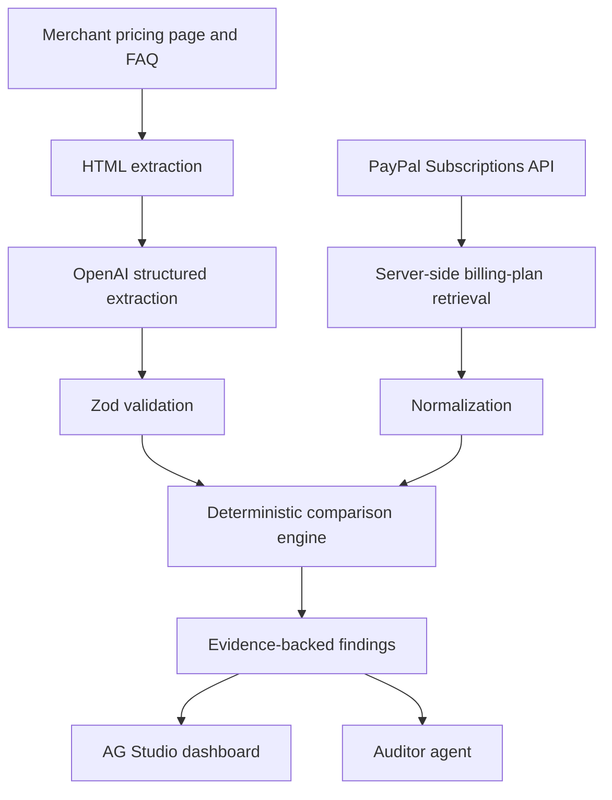

# PlanMirror

> **PayPal backend setup:** See [the sandbox integration guide](docs/paypal-sandbox.md) for the implemented protected list/detail routes, environment setup, mocked tests, live verification, and Quillfox test-plan provisioning. The historical prototype/demo sections below describe work beyond the current main application; the comparison engine, extraction and AG Studio integration are separate teammate workstreams.

**AI-Powered Subscription Billing Integrity Auditor**

A merchant-side auditing application for comparing advertised subscription promises with the actual billing configuration stored in PayPal. Built for the PayPal AI Hackathon 2026.

> **Start on `main`.** This branch contains the runnable team starter and shared types. The sections below describe the project design and the prototype on [`backup-mvp`](https://github.com/HozaifAwan/hackathon-project/tree/backup-mvp). Demo controls and integration examples refer to that branch. See [Team handoff](#team-handoff) for your starting files.

> **Backup prototype: Quillfox demo available.** Compare the published Quillfox offer with a labeled sample or an authorized PayPal sandbox plan. Inspect the results in AG Studio. The sandbox audit can extract terms from the Quillfox pricing copy with OpenAI. General webpage extraction and the AI Auditor agent are planned.

## Project overview

PlanMirror helps merchants discover when pricing pages, FAQs, and terms disagree with their PayPal subscription plans before customers encounter unexpected charges. It supports billing transparency and merchant reliability through evidence-backed findings and suggested corrections.

**Example:** a merchant advertises a 30-day free trial followed by $9.99/month, but PayPal is configured for a 7-day trial followed by $9.99/month. PlanMirror should flag the **23-day trial discrepancy**, show the original wording and retrieved configuration, and recommend reviewing the website or plan. The monthly price matches.

PlanMirror is an auditing aid. It does not guarantee FTC compliance, certify legal compliance, or prevent every billing dispute.

## Problem and solution

Marketing copy and payment settings are often maintained separately. A promotion changes, an FAQ becomes stale, or a billing plan is edited without updating the website. A correct-looking checkout page alone cannot establish that the backend plan matches the offer.

The planned workflow:

1. Retrieve an allowlisted merchant pricing page and relevant FAQ/terms pages.
2. Extract visible text with source URLs and evidence snippets.
3. Use AI to turn natural-language promises into structured candidate terms.
4. Validate that output with Zod and normalize real PayPal sandbox plan data.
5. Use deterministic code and Decimal.js to compare compatible financial terms.
6. Present matches, discrepancies, conflicting sources, and cases requiring review in AG Studio.

AI interprets wording; deterministic code verifies financial comparisons. Missing evidence or ambiguous plan mapping must produce **needs review**, not an invented match.

## Tech stack — foundation and planned integrations

| Technology | Planned responsibility |
| --- | --- |
| Next.js (App Router) | One application with server-side routes and UI |
| React + TypeScript | Typed components and application logic |
| Tailwind CSS | Responsive styling |
| AG Studio | Interactive findings dashboards and custom Auditor agent |
| PayPal REST Subscriptions API | Real sandbox billing-plan retrieval |
| OpenAI Responses API | Structured extraction and grounded explanations |
| Zod | Validate extracted terms and application boundaries |
| Decimal.js | Exact decimal arithmetic for financial comparisons |
| Native Fetch + Cheerio | Controlled HTML retrieval and text extraction |
| Playwright | Optional fallback only when JavaScript rendering is required |
| Vercel | Planned hosting; no deployment yet |

There is **no separate Express, FastAPI, or Python backend**. PayPal and OpenAI calls belong in server-side Next.js code. Installed versions are recorded in the npm lockfile.

## System architecture — planned



The extraction branch retains source quotes and URLs. The PayPal branch retains plan identifiers and retrieval timestamps. Both branches must map to the same merchant, plan, currency, and offer context before comparison. The Auditor agent explains findings from these records; it must not invent billing values or silently change plans.

## Core features and build status

**Implemented:** Next.js App Router shell, Tailwind styling, shared TypeScript contracts, and local development checks.

| Planned feature | Expected behavior | Status |
| --- | --- | --- |
| Merchant pricing-page analysis | Read approved pricing, FAQ, and terms pages | Planned |
| PayPal sandbox retrieval | Retrieve a specific sandbox plan by ID | Implemented, live credential test pending |
| Structured AI extraction | Extract price, currency, trial, frequency, fees, and source evidence | Planned |
| Trial and price checks | Detect supported discrepancies with deterministic comparisons | Planned |
| Annual/monthly equivalence | Compare equivalent amounts while preserving billing cadence | Planned |
| Evidence and explanations | Show source quotes beside retrieved PayPal fields | Planned |
| AG Studio dashboard | Filter and inspect findings by plan, field, and severity | Planned |
| Custom Auditor agent | Answer questions grounded in retrieved audit evidence | Planned |
| Suggested corrections | Recommend human-reviewed changes without automatic writes | Planned |

## Five demo scenarios — Quillfox

Quillfox is a **fictional merchant**. These are planned demo fixtures and acceptance cases, not completed audit results. All amounts below are USD.

| Scenario | Advertised terms | PayPal / other evidence | Expected outcome |
| --- | --- | --- | --- |
| 1. Trial mismatch | 30-day free trial | 7-day free trial | Flag a 23-day discrepancy |
| 2. Price mismatch | $19/month | $24/month | Flag a $5/month discrepancy |
| 3. Stale FAQ | FAQ: $49/month | Pricing page and PayPal: $59/month | Flag conflicting website sources; identify the FAQ as the candidate stale source for review |
| 4. Annual equivalence | $8.25/month, billed annually | $99/year | Amounts match because $8.25 × 12 = $99, when currency and all other terms agree |
| 5. Wording equivalence | “Try free for thirty days” | 30-day free trial | Match equivalent wording; never automatically equate one calendar month with 30 days |

Annual equivalence does **not** mean monthly collection equals annual collection. Preserve upfront payment, renewal cadence, taxes, setup fees, trial charges, discounts, and quantity context. Compare like with like; unsupported cases require review.

## PayPal integration — planned

- `GET /v1/billing/plans`: list the authorized merchant’s plans, following pagination.
- `GET /v1/billing/plans/{id}`: retrieve authoritative details for each selected plan.
- Use `Prefer: return=representation` on detailed plan listings where supported; retrieve individual plan details when required fields are missing.
- Optional: `GET /v1/billing/subscriptions` for merchant subscription listing, subject to endpoint availability and account permissions. It is not required for the initial plan audit.
- If subscription-level audits are added, inspect effective subscription overrides rather than assuming the base plan describes every subscriber.

Authenticate server-side using OAuth client credentials against the PayPal sandbox. Keep client secrets and access tokens on the server; never place them in client bundles, screenshots, logs, or commits. The initial product is read-only: auditing does not create subscriptions, charge customers, or modify prices.

References: [Subscriptions API](https://developer.paypal.com/api/subscriptions/v1) · [List plans and response preferences](https://developer.paypal.com/api/subscriptions/v1/plans-list/) · [PayPal developer dashboard](https://developer.paypal.com/dashboard/)

### Sandbox plan endpoint

For local development, configure `PAYPAL_CLIENT_ID` and `PAYPAL_CLIENT_SECRET` for the sandbox merchant that owns the plan. Set `PLANMIRROR_SANDBOX_READ_TOKEN` to a random secret of at least 32 characters in `.env.local`. The endpoint is disabled without that token. Use an HTTP client to send `GET /api/paypal/plans/P-...` with the token in the Authorization Bearer header. Keep the token out of frontend code and leave the endpoint disabled on public demo deployments.

The endpoint uses PayPal's sandbox OAuth and plan details APIs. The server shares an OAuth token between concurrent reads, refreshes it before expiry, and retries a rejected token once. Plan details are fetched fresh for every audit. The response contains normalized billing cycles, decimal price strings, and retrieval time. Missing fixed prices, tiered pricing, taxes, and quantity-dependent terms require explicit handling by the comparison engine. An OAuth or plan retrieval error produces an error response rather than sample billing data.

### Run the Quillfox demo

1. Open the home page and follow **View Quillfox pricing page** to see the advertised offer.
2. Run the mismatch demo. It compares the offer with a labeled sample plan that has a seven-day trial and a $19.99 monthly price.
3. Rerun with the corrected sample to see both checks match.
4. Inspect the editable AG Studio evidence grid under **Audit findings**. Use the toggle to collapse it.
5. To use actual PayPal data, open **Audit a live PayPal sandbox plan** and supply a sandbox plan ID and your local audit token. Select a plan intended to implement the Quillfox offer. With **Extract Quillfox’s advertised terms with AI** enabled, set `OPENAI_API_KEY` in `.env.local` and restart the server. The audit checks the structured model response against the published Quillfox copy before comparing it to PayPal. Uncheck AI extraction to use the known Quillfox terms. An error is shown separately and never presented as live data.

The comparison supports one free trial expressed in days and one fixed monthly renewal in USD. Unsupported cycles or pricing conditions require review. The sample rerun changes only the demo data.

### AG Studio demo acceptance

The Quillfox demo should use a real PayPal sandbox plan ID and show the source URL, quoted website terms, and PayPal field behind each finding. The comparison engine decides match, mismatch, or needs review. The planned AG Studio dashboard will expose these findings through a custom evidence widget, cross-filterable views, and a themed layout. The Auditor agent should use the Studio Agent Framework to answer questions from those same records. The demo should show the mismatch clearing after the public offer or sandbox configuration is corrected and the audit is rerun.

See [Devpost's AG Grid sponsor guidance](https://paypalaihackathon.devpost.com/details/aggrid).

## Local development

Use Node.js 20.9 or later and npm. From the repository checkout:

```bash
npm ci
npm run dev
```

Open [localhost:3000](http://localhost:3000). The landing page runs without credentials.
When working on integrations, copy `.env.example` to the Git-ignored `.env.local`.
Use sandbox PayPal credentials and keep the OpenAI key server-side.

```bash
npm run lint
npm run typecheck
npm run build
```

## Project structure

| Path | Purpose |
| --- | --- |
| `app/layout.tsx` | Root layout, metadata, and global styles |
| `app/page.tsx` | Foundation landing page |
| `app/globals.css` | Tailwind entry point |
| `lib/paypal/types.ts` | Normalized PayPal plans and billing cycles |
| `lib/audit/types.ts` | Money, intervals, advertised claims, findings, and evidence |
| `.env.example` | Empty server-side environment variable placeholders |

The contracts preserve decimal amounts as strings and distinguish a quoted rate from the actual billing interval. Findings can require review when evidence is incomplete. Add runtime schemas and integration dependencies alongside the features that use them.

## Team collaboration

### Contributor guide

After cloning, start each task from an updated main branch and create a feature branch:

```bash
git switch main
git pull --ff-only origin main
git switch -c feature/your-task
```

Review changes and stage only intended files. For a README contribution, for example:

```bash
git diff
git add README.md
git diff --cached
git commit -m "docs: clarify project documentation"
git push -u origin feature/your-task
```

Open a pull request on GitHub targeting `main`. Explain the change, validation performed, and any limitations. Request teammate review before merging and keep `main` stable. Once application checks exist, run the documented checks and include their results. Never commit secrets, access tokens, private merchant data, or filled environment files. Review staged changes before every commit.

### Technical workstreams

See [Team handoff](#team-handoff) for named owners and starting files.

| Area | Scope |
| --- | --- |
| PayPal / Backend | Sandbox OAuth, plan retrieval, pagination, server boundaries |
| AI / Comparison Engine | Extraction schemas, evidence, normalization, deterministic checks |
| Frontend / AG Studio | Findings dashboard, interactions, Auditor agent |
| Demo / Integration / Documentation | Quillfox scenarios, end-to-end verification, README and video |

## Hackathon timeline — November 2026

| Dates | Team milestone |
| --- | --- |
| November 1–3 | Foundation and PayPal integration |
| November 4–7 | Core AI, comparison engine, dashboard |
| November 8–9 | Integration, testing, UI polish |
| November 10 | Feature freeze |
| November 11 | Final documentation, video, submission |
| November 12 | Official deadline: **12 PM Pacific (PST) / 2 PM Houston (CST)** |

## Future enhancements — stretch goals

- [ ] PayPal webhook-triggered audits.
- [ ] Subscriber impact analysis using effective subscription terms.
- [ ] Human-approved sandbox price corrections, with explicit confirmation and recorded changes.
- [ ] Audit history and version comparisons.
- [ ] Multi-merchant onboarding with isolated credentials and data.
- [ ] Additional payment providers.

## Security and limitations

- Keep API keys, PayPal secrets, and bearer tokens server-side. Redact sensitive logs and use least-privilege access.
- Require authorization and rate limits on audit and AI routes before exposing them publicly. Bound request sizes, fetch time, and AI usage.
- Scrape only controlled, explicitly allowlisted merchant URLs. Reject local/private network destinations and revalidate redirects to prevent server-side request forgery. Respect site permissions and access restrictions.
- Treat fetched website text as untrusted data, never as agent instructions. Do not let page content authorize tool calls or price modifications.
- Sandbox testing is separate from production billing; the demo must not use production credentials or charge real customers.
- Every financial discrepancy needs actual source evidence and retrieved billing data. AI extraction can be wrong; retain confidence/uncertainty and allow human review.
- Different currencies, calendar units, taxes, regional offers, quantities, discounts, and subscription overrides can change the conclusion. Do not assume equivalence without matching context.
- Price modifications require human approval. The planned initial auditor has no automatic price-write behavior.
- PlanMirror is not a legal-compliance certification service and makes no guarantee of FTC compliance or dispute prevention.

## License and submission readiness

**License status: unresolved.** This repository currently has no license file. Choosing and adding an appropriate open-source license for the team’s original work is an open task, not a completed step.

The [official PayPal + AG Grid starter](https://github.com/paypaldev/hackathon-paypal-ag-grid-boilerplate) was inspected as a reference. Its visible root file listing and repository metadata did not establish a redistribution license. Do not assume public visibility grants reuse permission, copy its source, or apply MIT to third-party code. Obtain clear permission or independently implement the application; verify dependency and AG Studio terms separately and retain required notices. No starter source was copied for this documentation update.

Submission checklist, based on the [official rules](https://paypalaihackathon.devpost.com/rules):

- [ ] Deliver a working application with central PayPal sandbox and AI integration.
- [ ] Make the code repository public with all necessary source, assets, and reproducible instructions. Visibility remains private until the owner approves changing it.
- [ ] Include a detectable open-source license after resolving ownership and third-party permissions.
- [ ] Provide a clear project explanation and functional demo access, through complete run instructions or a hosted demo.
- [ ] Provide a public YouTube demonstration video under three minutes showing the app working.
- [ ] Prepare an AI-tools statement identifying tools/models, their roles in the app and development, and human verification; confirm the current submission form’s disclosure fields.
- [ ] Recheck the submission form, official rules, and any sponsor-specific requirements before submission.

The AI-tools statement is a team documentation deliverable; do not treat an unverified disclosure format as a quoted rule. No video, deployment, completed audit results, or submission is claimed here.

## Official documentation

- [Next.js App Router](https://nextjs.org/docs/app)
- [AG Studio](https://www.ag-grid.com/studio/react/) and [Studio Agent Framework](https://www.ag-grid.com/studio/react/ai-agents/)
- [OpenAI Responses API](https://platform.openai.com/docs/api-reference/responses)
- [Zod](https://zod.dev/) · [Decimal.js](https://mikemcl.github.io/decimal.js/) · [Cheerio](https://cheerio.js.org/)
- [PayPal AI Hackathon](https://paypalaihackathon.devpost.com/)

## Additions by Hozaif

- **Portable audit evidence.** Use **Download evidence report** to save a JSON record for a teammate investigating an offer. It includes the Quillfox source link and quote, whether OpenAI extracted the terms, the sample or sandbox source label, the PayPal retrieval timestamp for sandbox audits, and every finding with its plan ID and PayPal field. The download includes all findings even when the dashboard is filtered. API keys and audit tokens are excluded.
- **Polished demo dashboard.** The audit and AG Studio share a blue palette, and the audit opens with the evidence grid visible. The status controls let judges isolate discrepancies before downloading the complete record.
- **Two-minute recording sequence.** Spend 20 seconds showing Quillfox’s public-facing promise, 45 seconds running an authorized sandbox audit with AI extraction and showing the verified quote, 35 seconds inspecting a discrepancy and downloading its evidence, and 20 seconds running the labeled corrected sample. The corrected sample demonstrates the expected outcome using fixture data. Record the sandbox run with the token field masked and keep the final video under three minutes. [Devpost official rules](https://paypalaihackathon.devpost.com/rules)
- **Submission checks.** Before recording, verify one actual PayPal sandbox and OpenAI run from a clean setup. The public repository and open-source license are separate submission requirements and still need team resolution. The AG Grid prize guidance emphasizes custom widgets, theming, layout, and Studio Agent Framework integration. The themed evidence grid is implemented, while a custom widget and Auditor agent remain open. [AG Grid sponsor guidance](https://paypalaihackathon.devpost.com/details/aggrid)


## Team handoff

Pull `main`, create a feature branch, and open your PR against `main`. Suggested paths in the table may need to be created. Coordinate changes to shared contracts with Hozaif before building against them.

| Teammate | Role | Start here | Coordinate with |
| --- | --- | --- | --- |
| Hozaif | Project Lead & System Architect | Shared contracts in `lib/audit/types.ts` and `lib/paypal/types.ts`, integration, and PRs | Everyone on contract changes |
| Ayaan | PayPal API & Backend | `lib/paypal/types.ts`, then add the sandbox client under `lib/paypal/` and routes under `app/api/paypal/` | Nilanee on normalized plans and Leen on endpoint security |
| Sujeeth | AI/LLM | `lib/audit/types.ts`, then add extraction and evidence validation under `lib/ai/` | Nilanee on claim shapes and Sebastian on evidence for the agent |
| Nilanee | Business Logic & QA | `lib/audit/types.ts`, then add comparisons and tests under `lib/audit/` | Ayaan and Sujeeth on inputs and Sebastian on findings |
| Crystalline | Frontend/UI | `app/page.tsx` and `app/globals.css`, then add the Quillfox pricing page under `app/quillfox/` | Sebastian on dashboard placement and Sujeeth on pricing copy |
| Sebastian | AG Studio & Agent | `lib/audit/types.ts`, then add the dashboard, Mirror widget, and Auditor agent under `app/studio/` | Crystalline on layout, Nilanee on findings, and Sujeeth on source evidence |
| Leen | DevOps, Security & Demo | `.env.example` and `.github/workflows/checks.yml`, then own deployment and demo verification | Ayaan and Sujeeth on credentials and Hozaif on release readiness |

Start by agreeing on the handoffs. Ayaan returns normalized PayPal plans, Sujeeth returns structured claims with source quotes, Nilanee compares those inputs and produces findings, and Sebastian renders the findings in the dashboard. Crystalline owns the merchant and audit screens. Leen verifies the complete flow with sandbox credentials and prepares the demo.
