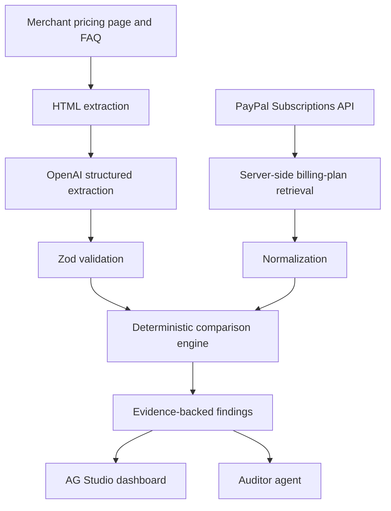

# PlanMirror

**AI-Powered Subscription Billing Integrity Auditor**

A merchant-side auditing application for comparing advertised subscription promises with the actual billing configuration stored in PayPal. Built for the PayPal AI Hackathon 2026.

> **Status: planning / documentation only.** The repository currently contains this README and a Python-template `.gitignore`. No application, dependency manifest, environment example, tests, or deployment exists yet. Every application capability below is planned, not implemented. The chosen architecture uses TypeScript; the existing Python ignore template does not imply a Python backend.

## Project overview

PlanMirror helps merchants discover when pricing pages, FAQs, and terms disagree with their PayPal subscription plans before customers encounter unexpected charges. It supports billing transparency and merchant reliability through evidence-backed findings and suggested corrections.

**Example:** a merchant advertises a 30-day free trial followed by $9.99/month, but PayPal is configured for a 7-day trial followed by $9.99/month. PlanMirror should flag the **23-day trial discrepancy**, show the original wording and retrieved configuration, and recommend reviewing the website or plan. The monthly price matches.

PlanMirror is an auditing aid. It does not guarantee FTC compliance, certify legal compliance, or prevent every billing dispute.

## Problem and solution

Marketing copy and payment settings are often maintained separately. A promotion changes, an FAQ becomes stale, or a billing plan is edited without updating the website. A correct-looking checkout page alone cannot establish that the backend plan matches the offer.

The planned workflow:

1. Retrieve an allowlisted merchant pricing page and relevant FAQ/terms pages.
2. Extract visible text with source URLs and evidence snippets.
3. Use AI to turn natural-language promises into structured candidate terms.
4. Validate that output with Zod and normalize real PayPal sandbox plan data.
5. Use deterministic code and Decimal.js to compare compatible financial terms.
6. Present matches, discrepancies, conflicting sources, and cases requiring review in AG Studio.

AI interprets wording; deterministic code verifies financial comparisons. Missing evidence or ambiguous plan mapping must produce **needs review**, not an invented match.

## Tech stack — finalized architecture, implementation pending

| Technology | Planned responsibility |
| --- | --- |
| Next.js (App Router) | One application with server-side routes and UI |
| React + TypeScript | Typed components and application logic |
| Tailwind CSS | Responsive styling |
| AG Studio | Interactive findings dashboards and custom Auditor agent |
| PayPal REST Subscriptions API | Real sandbox billing-plan retrieval |
| OpenAI Responses API | Structured extraction and grounded explanations |
| Zod | Validate extracted terms and application boundaries |
| Decimal.js | Exact decimal arithmetic for financial comparisons |
| Native Fetch + Cheerio | Controlled HTML retrieval and text extraction |
| Playwright | Optional fallback only when JavaScript rendering is required |
| Vercel | Planned hosting; no deployment yet |

There is **no separate Express, FastAPI, or Python backend**. PayPal and OpenAI calls belong in server-side Next.js code. Package versions and scripts will be documented after initialization.

## System architecture — planned



The extraction branch retains source quotes and URLs. The PayPal branch retains plan identifiers and retrieval timestamps. Both branches must map to the same merchant, plan, currency, and offer context before comparison. The Auditor agent explains findings from these records; it must not invent billing values or silently change plans.

## Core features and build status

**Implemented:** repository initialization and project documentation only.

| Planned feature | Expected behavior | Status |
| --- | --- | --- |
| Merchant pricing-page analysis | Read approved pricing, FAQ, and terms pages | Planned |
| PayPal sandbox retrieval | Retrieve real plan details with pagination | Planned |
| Structured AI extraction | Extract price, currency, trial, frequency, fees, and source evidence | Planned |
| Trial and price checks | Detect supported discrepancies with deterministic comparisons | Planned |
| Annual/monthly equivalence | Compare equivalent amounts while preserving billing cadence | Planned |
| Evidence and explanations | Show source quotes beside retrieved PayPal fields | Planned |
| AG Studio dashboard | Filter and inspect findings by plan, field, and severity | Planned |
| Custom Auditor agent | Answer questions grounded in retrieved audit evidence | Planned |
| Suggested corrections | Recommend human-reviewed changes without automatic writes | Planned |

## Five demo scenarios — Quillfox

Quillfox is a **fictional merchant**. These are planned demo fixtures and acceptance cases, not completed audit results. All amounts below are USD.

| Scenario | Advertised terms | PayPal / other evidence | Expected outcome |
| --- | --- | --- | --- |
| 1. Trial mismatch | 30-day free trial | 7-day free trial | Flag a 23-day discrepancy |
| 2. Price mismatch | $19/month | $24/month | Flag a $5/month discrepancy |
| 3. Stale FAQ | FAQ: $49/month | Pricing page and PayPal: $59/month | Flag conflicting website sources; identify the FAQ as the candidate stale source for review |
| 4. Annual equivalence | $8.25/month, billed annually | $99/year | Amounts match because $8.25 × 12 = $99, when currency and all other terms agree |
| 5. Wording equivalence | “Try free for thirty days” | 30-day free trial | Match equivalent wording; never automatically equate one calendar month with 30 days |

Annual equivalence does **not** mean monthly collection equals annual collection. Preserve upfront payment, renewal cadence, taxes, setup fees, trial charges, discounts, and quantity context. Compare like with like; unsupported cases require review.

## PayPal integration — planned

- `GET /v1/billing/plans`: list the authorized merchant’s plans, following pagination.
- `GET /v1/billing/plans/{id}`: retrieve authoritative details for each selected plan.
- Use `Prefer: return=representation` on detailed plan listings where supported; retrieve individual plan details when required fields are missing.
- Optional: `GET /v1/billing/subscriptions` for merchant subscription listing, subject to endpoint availability and account permissions. It is not required for the initial plan audit.
- If subscription-level audits are added, inspect effective subscription overrides rather than assuming the base plan describes every subscriber.

Authenticate server-side using OAuth client credentials against the PayPal sandbox. Keep client secrets and access tokens on the server; never place them in client bundles, screenshots, logs, or commits. The initial product is read-only: auditing does not create subscriptions, charge customers, or modify prices.

References: [Subscriptions API](https://developer.paypal.com/api/subscriptions/v1) · [List plans and response preferences](https://developer.paypal.com/api/subscriptions/v1/plans-list/) · [PayPal developer dashboard](https://developer.paypal.com/dashboard/)

## Local development

### Available now

With Git installed and repository access granted:

```bash
git clone https://github.com/HozaifAwan/hackathon-project.git
cd hackathon-project
```

The repository is currently private; use your own GitHub authentication. Do not put tokens in the clone URL.

### Pending application initialization

There is no `package.json`, lockfile, application directory, or runnable app yet. Dependency-install and start commands are therefore **pending**; do not assume `npm install` or `npm run dev` works in this repository.

The foundation work will initialize Next.js App Router with React, TypeScript, and Tailwind, add the listed dependencies, establish server-side integrations, and then document the actual package manager, runtime requirements, install/build/test/start scripts, and local URL.

An `.env.example` is **planned but does not exist**. Its variable names will be chosen and documented alongside the implementation; none are defined here as existing configuration. It must contain variable names and empty placeholders only, never credentials. Intended configuration covers PayPal sandbox authentication, OpenAI server authentication/model selection, and AG Studio licensing as required by its documentation. Local values will stay in an ignored environment file, with hosted secrets configured separately.

## Project structure

Current root contents:

```text
.gitignore    # Existing Python template; review for Next.js during foundation work
README.md     # Project plan and contributor guide
```

Proposed structure — **not created yet**:

```text
app/          # App Router pages and server-side API routes
components/   # Audit interface and AG Studio integration
lib/          # PayPal retrieval, extraction, schemas, normalization, comparisons
tests/        # Deterministic comparison and integration coverage
public/       # Approved static assets
.env.example  # Names and empty placeholders only
```

## Team collaboration

### Contributor guide

After cloning, start each task from an updated main branch and create a feature branch:

```bash
git switch main
git pull --ff-only origin main
git switch -c feature/your-task
```

Review changes and stage only intended files. For a README contribution, for example:

```bash
git diff
git add README.md
git diff --cached
git commit -m "docs: clarify project documentation"
git push -u origin feature/your-task
```

Open a pull request on GitHub targeting `main`. Explain the change, validation performed, and any limitations. Request teammate review before merging and keep `main` stable. Once application checks exist, run the documented checks and include their results. Never commit secrets, access tokens, private merchant data, or filled environment files. Review staged changes before every commit.

### Provisional responsibility areas

Assignments remain open; these are work areas, not named team assignments.

| Area | Scope |
| --- | --- |
| PayPal / Backend | Sandbox OAuth, plan retrieval, pagination, server boundaries |
| AI / Comparison Engine | Extraction schemas, evidence, normalization, deterministic checks |
| Frontend / AG Studio | Findings dashboard, interactions, Auditor agent |
| Demo / Integration / Documentation | Quillfox scenarios, end-to-end verification, README and video |

## Hackathon timeline — November 2026

| Dates | Team milestone |
| --- | --- |
| November 1–3 | Foundation and PayPal integration |
| November 4–7 | Core AI, comparison engine, dashboard |
| November 8–9 | Integration, testing, UI polish |
| November 10 | Feature freeze |
| November 11 | Final documentation, video, submission |
| November 12 | Official deadline: **12 PM Pacific (PST) / 2 PM Houston (CST)** |

## Future enhancements — stretch goals

- [ ] PayPal webhook-triggered audits.
- [ ] Subscriber impact analysis using effective subscription terms.
- [ ] Human-approved sandbox price corrections, with explicit confirmation and recorded changes.
- [ ] Audit history and version comparisons.
- [ ] Multi-merchant onboarding with isolated credentials and data.
- [ ] Additional payment providers.

## Security and limitations

- Keep API keys, PayPal secrets, and bearer tokens server-side. Redact sensitive logs and use least-privilege access.
- Require authorization and rate limits on audit and AI routes before exposing them publicly. Bound request sizes, fetch time, and AI usage.
- Scrape only controlled, explicitly allowlisted merchant URLs. Reject local/private network destinations and revalidate redirects to prevent server-side request forgery. Respect site permissions and access restrictions.
- Treat fetched website text as untrusted data, never as agent instructions. Do not let page content authorize tool calls or price modifications.
- Sandbox testing is separate from production billing; the demo must not use production credentials or charge real customers.
- Every financial discrepancy needs actual source evidence and retrieved billing data. AI extraction can be wrong; retain confidence/uncertainty and allow human review.
- Different currencies, calendar units, taxes, regional offers, quantities, discounts, and subscription overrides can change the conclusion. Do not assume equivalence without matching context.
- Price modifications require human approval. The planned initial auditor has no automatic price-write behavior.
- PlanMirror is not a legal-compliance certification service and makes no guarantee of FTC compliance or dispute prevention.

## License and submission readiness

**License status: unresolved.** This repository currently has no license file. Choosing and adding an appropriate open-source license for the team’s original work is an open task, not a completed step.

The [official PayPal + AG Grid starter](https://github.com/paypaldev/hackathon-paypal-ag-grid-boilerplate) was inspected as a reference. Its visible root file listing and repository metadata did not establish a redistribution license. Do not assume public visibility grants reuse permission, copy its source, or apply MIT to third-party code. Obtain clear permission or independently implement the application; verify dependency and AG Studio terms separately and retain required notices. No starter source was copied for this documentation update.

Submission checklist, based on the [official rules](https://paypalaihackathon.devpost.com/rules):

- [ ] Deliver a working application with central PayPal sandbox and AI integration.
- [ ] Make the code repository public with all necessary source, assets, and reproducible instructions. Visibility remains private until the owner approves changing it.
- [ ] Include a detectable open-source license after resolving ownership and third-party permissions.
- [ ] Provide a clear project explanation and functional demo access, through complete run instructions or a hosted demo.
- [ ] Provide a public YouTube demonstration video under three minutes showing the app working.
- [ ] Prepare an AI-tools statement identifying tools/models, their roles in the app and development, and human verification; confirm the current submission form’s disclosure fields.
- [ ] Recheck the submission form, official rules, and any sponsor-specific requirements before submission.

The AI-tools statement is a team documentation deliverable; do not treat an unverified disclosure format as a quoted rule. No video, deployment, completed audit results, or submission is claimed here.

## Official documentation

- [Next.js App Router](https://nextjs.org/docs/app)
- [AG Studio](https://www.ag-grid.com/studio/react/) and [Studio Agent Framework](https://www.ag-grid.com/studio/react/ai-agents/)
- [OpenAI Responses API](https://platform.openai.com/docs/api-reference/responses)
- [Zod](https://zod.dev/) · [Decimal.js](https://mikemcl.github.io/decimal.js/) · [Cheerio](https://cheerio.js.org/)
- [PayPal AI Hackathon](https://paypalaihackathon.devpost.com/)
